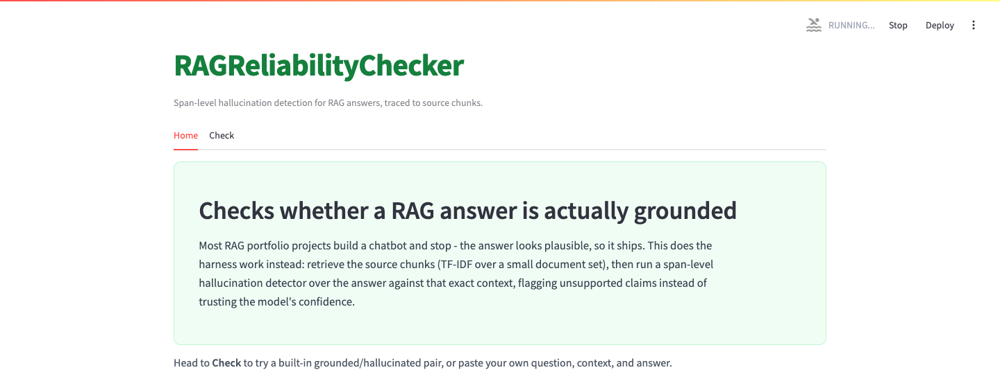
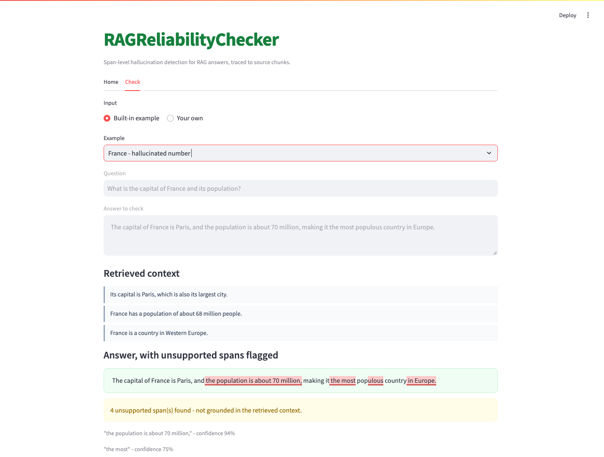

# RAGReliabilityChecker

    

Checks whether a RAG answer is actually grounded in what was retrieved,
flagging the exact unsupported spans instead of trusting the model's
confidence. A small factual document set is chunked and retrieved with
TF-IDF given a question - the retrieval half of this RAG pipeline. A
candidate answer is then checked against that retrieved context with a
span-level hallucination detector, which flags exactly which substrings
of the answer aren't supported and highlights them directly in the
answer with a confidence score each.

## Screenshots




## How to run

```bash
python -m venv .venv
source .venv/bin/activate
pip install torch --index-url https://download.pytorch.org/whl/cpu
pip install -r requirements.txt
streamlit run app.py
```

Tests: `python -m pytest tests/ -v`
